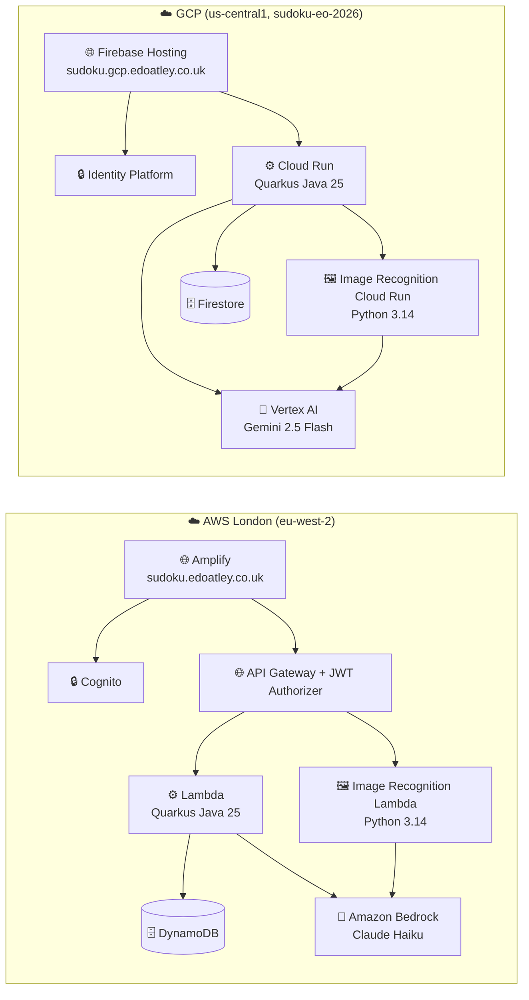
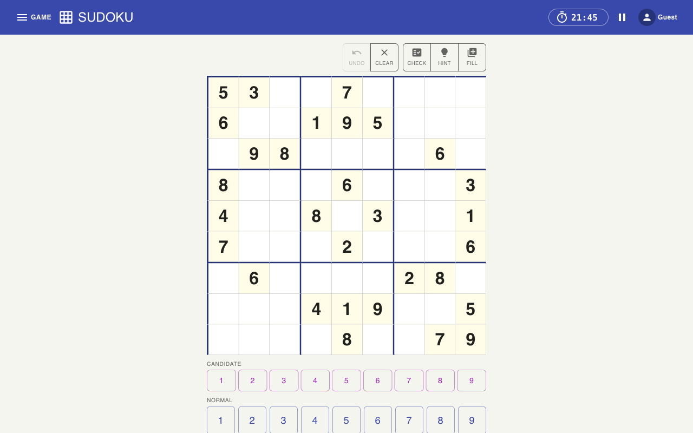
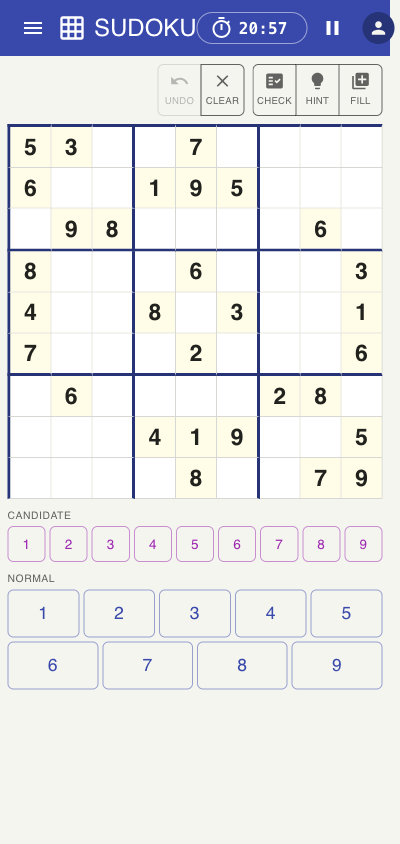

# Serverless Sudoku


A dual-cloud serverless Sudoku application with a Java/Quarkus backend and a React frontend, deployable to **AWS** (Lambda + Amplify + DynamoDB + Cognito, via Terraform) or **GCP** (Cloud Run + Firebase Hosting + Firestore + Identity Platform, via Pulumi Python).

## Contents

- [High-Level Architecture](#high-level-architecture)
- [Screenshots](#screenshots)
- [Tech Stack](#tech-stack)
- [Repository Structure](#repository-structure)
- [Documentation](#documentation)
- [Prerequisites](#prerequisites)
- [Local Development](#local-development)
- [API Reference](#api-reference)
- [Testing](#testing)
- [Key Files](#key-files)
- [Infrastructure](#infrastructure)
- [Deployment & Cloud Target Switching](#deployment--cloud-target-switching)
- [Contributing](#contributing)

---

## High-Level Architecture

The application supports two independent cloud deployments controlled via branch naming (`rc-*` vs `rcg-*`) or the `DEPLOY_TARGET` repository variable (`aws` | `gcp` | `both`):



See [`infra/aws/README.md`](infra/aws/README.md) and [`infra/gcp/README.md`](infra/gcp/README.md) for the full deployment-level architecture and stack layout.

---

## Screenshots

| Desktop | Mobile |
|---------|--------|
|  |  |

---

## Tech Stack

| Layer      | AWS (`infra/aws/`)                                                 | GCP (`infra/gcp/`)                                                 |
|------------|--------------------------------------------------------------------|--------------------------------------------------------------------|
| Frontend   | React 19, Vite 8, MUI v9 (`VITE_AUTH_PROVIDER=cognito`)            | React 19, Vite 8, MUI v9 (`VITE_AUTH_PROVIDER=firebase`)           |
| Backend    | Java 25, Quarkus 3.36.1, `quarkus-oidc` (`STORAGE_PROVIDER=dynamodb`) | Java 25, Quarkus 3.36.1, `quarkus-oidc` (`STORAGE_PROVIDER=firestore`) |
| Auth       | Amazon Cognito User Pool (email/password + Google OAuth 2.0)       | Google Identity Platform / Firebase Auth (email/password + Google) |
| Database   | AWS DynamoDB (`SudokuGames`, `SudokuPlayers`, `SudokuLeaderboard`, `SudokuCoachRateLimits`) | Google Cloud Firestore (`games`, `players`, `leaderboard`, `coach_rate_limits`) |
| AI         | Amazon Bedrock (Claude Haiku)                                      | Google Cloud Vertex AI (Gemini 2.5 Flash)                          |
| Hosting    | AWS Amplify (frontend), AWS Lambda container (backend)             | Firebase Hosting (frontend), Cloud Run v2 (backend + image recognition) |
| IaC        | Terraform (`eu-west-2`, S3 state)                                  | Pulumi Python (`us-central1`, `gs://sudoku-pulumi-state-eo` + Cloud KMS) |

---

## Repository Structure

```
sudoku-app/
├── backend/            # Java 25 + Quarkus REST API (AWS Lambda & GCP Cloud Run) → backend/README.md
│   └── src/
├── ui/                 # React 19 + Vite frontend with MUI                       → ui/README.md
│   ├── src/
│   └── e2e/            # Playwright E2E tests
├── image_recognition/  # Python service for puzzle photo scanning (Lambda & Cloud Run)
├── infra/
│   ├── aws/            # Terraform IaC (AWS eu-west-2)                           → infra/aws/README.md
│   └── gcp/            # Pulumi Python IaC (GCP sudoku-eo-2026)                  → infra/gcp/README.md
├── scripts/            # Local dev, infra, and CI/CD helper scripts              → scripts/README.md
├── docs/               # HLD, LLDs, EARS specs, arrows, openapi.yaml, coding standards
├── Makefile            # Combined dev workflow & cloud target switcher
└── CLAUDE.md           # AI assistant instructions
```

See the component READMEs for detailed usage:
- [`backend/README.md`](backend/README.md) — Java/Quarkus API, source structure, build profiles, testing
- [`ui/README.md`](ui/README.md) — React/Vite frontend, env vars, component structure
- [`infra/aws/README.md`](infra/aws/README.md) — AWS Terraform resources, multi-env strategy, bootstrap, deploy
- [`infra/gcp/README.md`](infra/gcp/README.md) — GCP Pulumi stacks (`bootstrap` + `app`), reusable components, tests
- [`scripts/README.md`](scripts/README.md) — Local dev scripts, CI/CD helpers, secret management
- [`scripts/infra/README.md`](scripts/infra/README.md) — Cloud bootstrap helpers and `cloud-target.sh`

---

## Documentation

This project follows a **Linked-Intent** approach, where intent flows `HLD → LLDs → EARS → Tests → Code` and docs are kept in sync with the code rather than left to rot. See [`CLAUDE.md`](CLAUDE.md) for the full workflow.

| Artifact                  | Location                                          | Purpose                                            |
|----------------------------|---------------------------------------------------|-----------------------------------------------------|
| High-Level Design (HLD)    | [`docs/high-level-design.md`](docs/high-level-design.md) | System overview and component map           |
| Low-Level Designs (LLDs)   | [`docs/llds/`](docs/llds/)                        | Per-component detailed design                       |
| EARS specs                 | [`docs/specs/`](docs/specs/)                      | Structured requirements, traced to code and tests   |
| Arrow tracking             | [`docs/arrows/index.yaml`](docs/arrows/index.yaml)| Traces each component from HLD through to code, flags gaps |
| Planning                   | [`docs/planning/`](docs/planning/)                | Implementation plans                                |
| Backlog                    | [`docs/todo/`](docs/todo/)                        | Deferred and future work items                      |

---

## Prerequisites

| Tool          | Version  | Notes                                           |
|---------------|----------|-------------------------------------------------|
| Java          | 25       | Temurin distribution recommended                |
| Node.js       | 22       |                                                 |
| Maven Wrapper | bundled  | Use `./mvnw` — no separate install              |
| Terraform     | latest   | Required for AWS infra work (`infra/aws/`)      |
| Pulumi + `uv` | latest   | Required for GCP infra work (`infra/gcp/`)      |
| GraalVM       | optional | Required for native image builds only           |

---

## Local Development

### Backend

```bash
cd backend
./mvnw quarkus:dev   # hot reload on http://localhost:8080
```

### Frontend

```bash
cd ui
npm install
npm run dev          # dev server on http://localhost:5173
```

### Combined (both services)

```bash
make dev             # starts backend (8080) and frontend (5173) in parallel
```

### Environment Variables

Copy `ui/.env.example` to `ui/.env.development.local` and adjust as needed:

```bash
cp ui/.env.example ui/.env.development.local
```

| Variable                    | Default                        | Description                                      |
|-----------------------------|--------------------------------|--------------------------------------------------|
| `VITE_API_URL`              | `http://localhost:8080/api/v1` | Backend API base URL                             |
| `VITE_MOCK_API`             | `false`                        | Set to `true` to bypass auth and use mock data   |
| `VITE_SKIP_AUTH`            | `false`                        | Set to `true` to bypass the Authenticator wrapper (test environments only) |
| `VITE_DEV_TOOLS`            | `false`                        | Set to `true` to enable developer-only menu items |
| `VITE_AI_COACH`             | `false`                        | Set to `true` to enable the AI Sudoku Coach panel (desktop only) |
| `VITE_COGNITO_USER_POOL_ID` | _(set by Terraform)_           | Cognito User Pool ID (not needed in mock mode)   |
| `VITE_COGNITO_CLIENT_ID`    | _(set by Terraform)_           | Cognito App Client ID (not needed in mock mode)  |
| `VITE_COGNITO_DOMAIN`       | _(set by Terraform)_           | Cognito hosted UI domain (not needed in mock mode) |

---

## API Reference

Base path: `/api/v1`. Full contract: [`docs/openapi.yaml`](docs/openapi.yaml).

**Public routes** (no authentication required):

| Method | Path                  | Description                                                      |
|--------|-----------------------|------------------------------------------------------------------|
| GET    | `/health`             | Health check                                                      |
| GET    | `/puzzles/generate`   | Generate a new puzzle (`?difficulty=easy\|medium\|hard\|expert`) |
| POST   | `/puzzles/validate`   | Validate the current board state                                 |
| POST   | `/puzzles/hint`       | Get a progressive logical hint (Nudge / Focus / Reveal)          |
| POST   | `/puzzles/candidates` | Calculate all valid candidates for empty cells                   |

**AI routes** (all under `/ai/*`, JWT required unless noted, Bedrock-backed):

| Method | Path                  | Description                                  |
|--------|-----------------------|----------------------------------------------|
| POST   | `/ai/coach`           | Send a message to the AI Sudoku coach (desktop only) |
| POST   | `/ai/image-to-puzzle`            | Extract a 9×9 grid from a puzzle photo       |
| GET    | `/ai/image-to-puzzle/warmup` | Warm up the image recognition Lambda (no auth required) |

**Protected routes** (JWT Bearer token required — issued by Cognito after Google login):

| Method | Path                  | Description                                  |
|--------|-----------------------|----------------------------------------------|
| POST   | `/games`              | Create a new game for the authenticated user |
| POST   | `/games/from-image`   | Create a new game from a scanned image grid  |
| GET    | `/games/current`      | Get the current in-progress game             |
| GET    | `/games/history`      | Get the player's completed game history      |
| GET    | `/games/{gameId}`     | Load a saved game                            |
| PATCH  | `/games/{gameId}`     | Save game progress                           |
| GET    | `/players/me`         | Get or create the current user's profile     |
| PATCH  | `/players/me`         | Update the current user's profile            |
| GET    | `/leaderboard`        | Get the league leaderboard                   |

---

## Testing

### Backend — Unit Tests

```bash
cd backend
./mvnw test
```

### Backend — Integration Tests

```bash
cd backend
./mvnw verify -DskipITs=false
```

### Frontend — E2E Tests (Playwright)

```bash
cd ui
npm run test:e2e       # headless Chromium
npm run test:e2e:ui    # interactive Playwright UI
```

CI runs all three test suites on every push. Playwright reports are uploaded as artifacts on failure.

---

## Key Files

| File                                               | Purpose                     |
|----------------------------------------------------|-----------------------------|
| [`docs/openapi.yaml`](docs/openapi.yaml)                             | API contract (source of truth)           |
| [`docs/high-level-design.md`](docs/high-level-design.md)             | System overview and component map        |
| [`docs/standards/java-quarkus.md`](docs/standards/java-quarkus.md)   | Backend coding standards                 |
| [`docs/llds/react-frontend.md`](docs/llds/react-frontend.md)         | Frontend LLD + coding standards          |
| [`docs/arrows/security-standards.md`](docs/arrows/security-standards.md) | Security standards (IAM, throttling, IDOR) |
| [`docs/arrows/testing-strategy.md`](docs/arrows/testing-strategy.md) | Test strategy                            |
| [`docs/llds/user-management.md`](docs/llds/user-management.md)       | Auth standards (Cognito / Identity Platform, JWT, OIDC) |
| [`docs/llds/cloud-platform.md`](docs/llds/cloud-platform.md)         | AWS IaC standards + CI/CD pipeline       |
| [`docs/llds/cloud-platform-gcp.md`](docs/llds/cloud-platform-gcp.md) | GCP Pulumi IaC design + CI/CD pipeline   |
| [`CLAUDE.md`](CLAUDE.md)                                             | AI assistant instructions                |

---

## Infrastructure

- **AWS (`infra/aws/`)**: Terraform configuration targeting `eu-west-2` (London), backed by S3 state. See [`infra/aws/README.md`](infra/aws/README.md) for architecture diagrams, resource details, bootstrap instructions, and local operations.
- **GCP (`infra/gcp/`)**: Two-stack Pulumi Python configuration (`bootstrap/` + `app/`) targeting `us-central1` in GCP project `sudoku-eo-2026`, backed by `gs://sudoku-pulumi-state-eo` and encrypted with Cloud KMS. See [`infra/gcp/README.md`](infra/gcp/README.md) and [`docs/runbooks/gcp-manual-setup.md`](docs/runbooks/gcp-manual-setup.md).

---

## Deployment & Cloud Target Switching

Deployment is orchestrated by [`.github/workflows/ci-deploy.yml`](.github/workflows/ci-deploy.yml), which runs the full test gate suite (`ci.yml`) and then delegates to the target cloud workflow(s).

### Live Environment URLs

| Cloud | Branch / Stack | Frontend URL | Custom Domain |
|-------|----------------|--------------|---------------|
| **AWS** | `main` (`prod`) | Amplify default URL | `https://sudoku.edoatley.co.uk` |
| **AWS** | `rc-*` (e.g. `rc-foo`) | Amplify branch URL | — |
| **GCP** | `main` (`prod`) | `https://sudoku-prod-13b8.web.app` | `https://sudoku.gcp.edoatley.co.uk` *(requires NS delegation of `gcp.edoatley.co.uk` in parent zone)* |
| **GCP** | `rcg-*` (e.g. `rcg-p7`) | `https://sudoku-dev-<stack>-13b8.web.app` (e.g. `https://sudoku-dev-rcg-p7-13b8.web.app`) | — |

### Branch & Target Routing

| Trigger | Cloud Deployed | Workflow |
|---------|----------------|----------|
| Push to `rc-*` | **AWS only** (`deploy-aws.yml`) | Builds Lambda container → ECR → Terraform `apply` → Amplify build → smoke test |
| Push to `rcg-*` | **GCP only** (`deploy-gcp-pulumi.yml`) | Builds Cloud Run containers → Artifact Registry → `pulumi up` → Firebase Hosting deploy → Identity Platform + `/api/v1/games` smoke test |
| Push to `main` | Controlled by GitHub repository variable **`DEPLOY_TARGET`** (`aws`, `gcp`, or `both`) | Runs `deploy-aws.yml`, `deploy-gcp-pulumi.yml`, or both in parallel |

### Switching the Active Cloud Target (`DEPLOY_TARGET`)

Use [`scripts/infra/shared/cloud-target.sh`](scripts/infra/shared/cloud-target.sh) or the `Makefile` target to inspect or flip which cloud `main` deploys to:

```bash
make cloud-target              # Show current DEPLOY_TARGET (aws | gcp | both)
make cloud-target TARGET=gcp   # Flip main-branch deployments to GCP (sudoku-eo-2026)
make cloud-target TARGET=aws   # Flip main-branch deployments to AWS
make cloud-target TARGET=both  # Deploy main to both AWS and GCP in parallel
```

Manual **Teardown** workflows (`workflow_dispatch`) are available for both clouds:
- AWS: `.github/workflows/teardown.yml` (`terraform destroy`)
- GCP: `.github/workflows/teardown-gcp-pulumi.yml` (`pulumi destroy` on `infra/gcp/app`)

---

## Contributing

This is a personal project. The linked-intent development workflow in [`CLAUDE.md`](CLAUDE.md) describes how code changes are made and how specs/LLDs are kept in sync.

### Inner-loop tooling

One-time setup (requires [Homebrew](https://brew.sh)):

```bash
make setup   # installs biome, ruff, trivy, checkov, terraform, pre-commit and wires up git hooks
```

After that, pre-commit hooks run automatically on every `git commit`, covering:
trailing whitespace · YAML check · Terraform fmt/validate · Ruff (Python) · Biome (JS/JSX) · Trivy security scan

On-demand checks:

```bash
make lint    # biome check + ruff + terraform fmt
make secure  # trivy fs + checkov
```

---

## TODO

See [`docs/todo/`](docs/todo/) for the backlog of deferred and upcoming work items.
